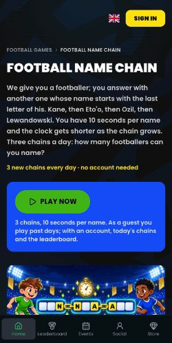

# QuizBall word game mobile performance

Mobile is improved but **not fixed**. [PR 672](https://github.com/Quizball-trivia/web/pull/672), [PR 675](https://github.com/Quizball-trivia/web/pull/675) and [PR 676](https://github.com/Quizball-trivia/web/pull/676) are merged and deployed to staging only. The latest default simulated mobile medians across the eight language/game pages range from 64 to 98: English 90/92, Spanish 84/85, Turkish 83/64, Georgian 83/98 (Played for Both / Name Chain). Each is the median of three runs, not a selected best result. All 24 latest mobile audits returned accessibility and best practices 100, with no console errors. Compared with the pre-change representative baseline, audit downloads are about 47% lower on Turkish Played for Both and 51% lower on English Name Chain. Loading and network response still vary materially; production has not changed, and the repeatable mobile 90+ goal remains unmet. Historical measurements and their different methods are retained below.

## Causes and implemented fixes

| Cause | Fix |
| --- | --- |
| The main illustration used lazy loading and a generic image size hint. | Load the hero eagerly with high fetch priority and a size hint matching its actual column. Keep related illustrations lazy. |
| The word game leaderboards imported their game engines and downloaded large avatar artwork before the visitor needed them. | Load the existing leaderboard and its scripts when its container enters view. Keep its existing data, language, account handling and daily calendar. |
| Launcher controls imported the full SEO catalogue. A server dynamic reference also brought unrelated FIFA artwork data into the loading path. | Extract the small launcher constants and defer the decorative FIFA artwork module until a FIFA tile mounts. |
| Related tiles requested images sized for a full mobile screen, despite their two or three column layout. | Supply image sizes matching the tile grid. |
| Links automatically fetched other game and sign in routes. | Disable prefetching on public game cards and account links; preserve destinations, click tracking and return paths. Navigating still fetches the destination normally. |
| The theme initialization script was blocked by the existing Content Security Policy. | Pass the request nonce to the theme provider. Do not weaken the policy. |
| White text on the green launch button and translucent text on blue cards failed contrast checks. | Use black launch text and solid white card descriptions. |

These image changes follow [Google's LCP guidance](https://web.dev/articles/optimize-lcp): the largest visible image should not be lazy loaded and should receive appropriate loading priority.

## Matched mobile measurements

Both versions were built from production commit `70a567a9`, served sequentially on the same `localhost:3000` origin and tested against the same production public API. The after version adds only this branch's changes. Public authentication configuration was supplied for both builds; local analytics had no production PostHog key. Tests used Chrome 154 and the same Lighthouse configuration for each before and after pair.

The following are medians of three runs per version using Lighthouse 13.0.1 with direct DevTools network and CPU throttling. MB means decimal megabytes. Downloads cover the audit navigation, not an entire gameplay session.

| Page | Performance before and after | LCP before and after | Blocking time before and after | Download before and after |
| --- | --- | --- | --- | --- |
| `/tr/futbol-oyunlari/ortak-futbolcu-oyunu` | 82 → 96 | 4.38 s → 2.25 s | 144 ms → 107 ms | 2.11 MB → 1.27 MB |
| `/en/football-games/football-name-chain` | 83 → 96 | 4.03 s → 2.34 s | 160 ms → 104 ms | 1.83 MB → 1.26 MB |

Accessibility improved from 96 to 100 and best practices from 92 to 100. The before runs recorded the blocked theme script; the after runs recorded no browser console errors. Initial-load layout shift stayed below 0.004 in these runs. This does not measure shifts during a whole scrolling or gameplay session.

### Default simulated Lighthouse remains below target

Lighthouse 13.5.0, the current registry release at verification time, was also tested with its default simulated mobile settings on the Turkish shared player page. One matched run per version returned performance 74 → 82, LCP 7.28 s → 4.57 s, accessibility 96 → 100 and best practices 92 → 100. A single run is not a stable benchmark.

After rebasing and rebuilding on `d629543e`, three more default simulated runs per representative page returned the following. These are final local after measurements, not a matched before and after comparison on that newer base.

| Final page | Performance median and range | LCP median | Blocking time median |
| --- | --- | --- | --- |
| Turkish shared player | 86, range 84–94 | 3.85 s | 144 ms |
| English Name Chain | 81, range 80–83 | 4.84 s | 73 ms |

Accessibility and best practices remained 100, with no console errors. The isolated score of 94 is not a consistent 90+ pass.

Earlier three-run simulated tests with Lighthouse 13.0.1 returned median performance 76 → 76 on the Turkish shared player page and 78 → 75 on English Name Chain. They did not establish a performance score improvement in that mode. After single-run simulated checks across all eight language variants ranged from 68 to 84, with accessibility and best practices both 100.

Direct throttling and simulated throttling are different measurement methods; the 96 score is not a prediction that PageSpeed Insights will show 96. [Google's Lighthouse documentation](https://github.com/GoogleChrome/lighthouse/blob/main/docs/throttling.md) explains the difference. The remaining initial payload includes shared application, authentication, analytics and all four language dictionaries. Further splitting needs regression review across account and language navigation, not removal of those features just to change a score.

## Verification

- 94 targeted regression tests passed in 17 files, including hero loading, deferred boards, all four locales, link tracking, signup return paths, runtime constants and the theme nonce.
- Changed TypeScript and TSX files passed lint; the standalone type check and production build passed. The build generated 277 pages.
- All eight local game URLs returned HTTP 200, one H1, the expected production canonical, high priority hero markup and no inline script missing its nonce. Local pages deliberately remain noindex; their local SEO score is not a production SEO assessment.
- Chrome checked English Name Chain and Turkish shared player launch and exit on desktop and at 390 by 844 pixels. Both loaded their localized guest intro without an account. Exit cleared the play query and closed the dialog. The deferred leaderboard appeared after entering view. The browser recorded no errors in these checks.
- No round was started or completed for verification. Authenticated gameplay, signup completion, every game mode and full-session layout stability are not certified by these checks.

## Release and remaining verification

The implementation is in the isolated `codex/word-games-mobile-performance` branch, rebased onto production `d629543e` after the Georgian naming update shipped during verification. Matched before and after measurements use the earlier `70a567a9` baseline; final rebased simulated checks are identified separately above. All 94 targeted tests and the production build passed again on the rebased version, and all eight HTML checks passed with the new Georgian name preserved. The original working checkout and its unrelated edits were left untouched. There are no database migrations, URL changes, indexing submissions or security policy relaxations in this fix.

Next gate: review and deploy through staging, repeat the public PageSpeed mobile tests on all eight pages, and check guest launch, leaderboard loading and account navigation before promotion. Production performance and real user Core Web Vitals remain unverified for this change. The previous origin level field assessment cannot be treated as page specific data or an immediate before and after test.

## Further optimization pass, 9 October

The React performance guidelines were used to separate code by when the visitor needs it. The reporting guidance was used to retain the historical measurements above and distinguish the new local evidence from production results.

| Remaining cost | Additional change |
| --- | --- |
| Opening the language selector's module imported the whole public game catalogue on every visit. | Load the translated route resolver when the language menu opens. Preserve translated slugs, query parameters, menu roles and the existing campaign fallback to English for Turkish. |
| Displaying a ranking still imported a playable word-game engine. | Extract the ranking, sign-in link and small game definitions into standalone modules. The page ranking no longer imports either engine or its animation UI. |
| Tiny avatar overlays downloaded their original 600px artwork. | Request responsive first-party thumbnails with the existing optimizer. Keep percentage positioning, hair masks, tints, custom CDN resolvers and un-sized preview consumers. |
| Guest navigation fetched account-only destinations in the background. | Disable navigation prefetch for loading and anonymous visitors; retain member prefetch, destinations, return paths and the sign-in guard. |
| Guest pages imported member reward, notification and friend invitation UI. | Defer those components until authenticated. Keep their underlying stores, receipt acknowledgements, polling, invitation actions and analytics unchanged. |

### Additional verification

- 206 targeted tests passed across 27 files in a sequential run. Coverage includes the earlier marketing and SEO tests, translated word-game and campaign links, avatar geometry and CDN compatibility, guest/member navigation, locale context, and reward receipt/polling behavior.
- A prior run concurrent with the production build had six reward animation timing failures. All 23 reward-flow tests passed in isolation, then the entire selected suite passed sequentially. No assertion or animation timeout was weakened to make these pass.
- All changed TypeScript/TSX files passed lint. The final production build, including TypeScript checking, passed and generated 277 pages.
- All eight local page URLs returned 200, one H1, the expected production canonical, one eager/high-priority hero and no inline script missing its nonce.
- Chrome verified deferred ranking appearance, language navigation from Turkish to the corresponding Spanish page, and Spanish/English guest intro opening and exit. A 390 by 844 mobile visual check showed the avatar layers and ranking rows rendering correctly without horizontal overflow. Visible avatar overlays used successful 32px/48px image requests instead of the raw originals.
- After the final member-only loading change, clicking Social as a guest still opened the sign-in dialog on the current public page. No account was created and no gameplay round was started.

These checks do not certify authenticated notification delivery, invitation acceptance, every avatar combination, completed signup, full gameplay sessions or production performance. Local analytics did not use a production PostHog key. One Chrome extension error was excluded from the application-error observations.

### Measurement limitations and remaining work

The default simulated mobile test still varies significantly between runs. Intermediate second-pass runs returned 74–80 before guest navigation prefetch was removed. After removing that prefetch and deferring reward UI, three runs per page returned median 79 for both representative pages, with downloads of 1.197 MB and 1.186 MB. Those runs did not establish a score improvement over the first-pass medians above. Final member-notification/invitation measurements are recorded below separately.

The remaining shared payload includes authentication, analytics, all four language dictionaries and some animation code used by shared loading UI. Splitting locale dictionaries and more of the application provider tree is a larger follow-up requiring account/language and event-delivery regression checks. Render-blocking global CSS and fonts remain visible in the audits. Nothing in this pass removes tracking, weakens authentication, changes gameplay rules or changes indexing/URLs.

### Final second-pass simulated mobile measurements

Lighthouse 13.5.0 and Chrome 154; medians of three runs per page on the final local production build. The mobile preset uses default simulated throttling. These are after measurements, not a new tightly matched baseline test.

| Page | Performance median and range | LCP median | Blocking time median | Download median |
| --- | --- | --- | --- | --- |
| Turkish shared player | 80, range 79–90 | 5.03 s | 124 ms | 1.193 MB |
| English Name Chain | 80, range 76–84 | 4.98 s | 95 ms | 1.182 MB |

Downloads were about 73 KB lower per representative page than the first-pass rebased measurements, roughly 6%. No account-only route prefetches appeared in any of these six navigations. Accessibility and best practices were 100 in all six runs; the console-error audit found none. Initial-load CLS stayed below 0.003.

The default simulated performance score did **not** improve overall: the earlier first-pass medians were 86 and 81. Blocking time decreased on the Turkish page but increased on English Name Chain. The payload reduction is verified; a stable mobile score or LCP improvement from this extra pass is not. The single Turkish score of 90 is not a consistent 90+ pass.

### Final second-pass desktop measurements

Same build, Lighthouse 13.5.0 desktop preset; medians of three runs per page. These are local after measurements, not proof of a desktop improvement over a matched baseline.

| Page | Performance median and range | LCP median | Blocking time median |
| --- | --- | --- | --- |
| Turkish shared player | 95, range 95–97 | 1.57 s | 0 ms |
| English Name Chain | 95, range 95–95 | 1.55 s | 0 ms |

Accessibility and best practices were 100 in all six desktop runs, with no console-error audit items. Initial-load CLS stayed below 0.017. One earlier desktop audit failed to record a navigation trace; it was retried rather than counted as a score.

At the time of this pass, the branch was local and had not been pushed, reviewed in a PR, deployed to staging or promoted to production. Before release, review the shared avatar and member-UI changes, validate authenticated notification/invitation/reward behavior on staging, and obtain real PageSpeed measurements there. A claim that every page or production Core Web Vitals is fixed would exceed the evidence.

## Further optimization pass, 10 October

This pass follows the React performance guidelines to separate optional components, routing constants and language assets from the initial page. The reporting guidance preserves the earlier evidence and identifies the latest results separately. It does not remove authentication, tracking or game functionality to improve an audit score.

### Changes implemented locally

| Initial loading cost | Change |
| --- | --- |
| A closed sign-in dialog loaded forms and requested their availability. | Load the dialog on its first opening and retain its host after closing, so pending authentication and recovery state are not discarded by the loading boundary. Load the animated authentication loading screen only when needed. |
| The root imported the complete flag-icons stylesheet. | Render the existing local SVG country flags without the global stylesheet. Preserve national and regional football flags and the existing flag-fill geometry. |
| Client helpers imported all four translation dictionaries. | Separate the small locale configuration from translation data. Ship English fallback plus the server-selected non-English dictionary; load another language when selected. Keep interpolation, fallback, URL, storage and account-language rules. |
| Guest route checks imported the entire public-game SEO catalogue. | Extract the unchanged localized folder and daily-collection constants. |
| Authentication startup imported validation code only to normalize email. | Extract the unchanged trim/lowercase helper; keep the existing validation module and rules. |
| A static logo imported the animation engine. | Load animation code only for an explicitly animated logo. Static logos retain their server-rendered artwork. |
| The shared public-page template referenced unrelated leaderboard implementations. | Load only the selected board implementation. Word-game rankings retain their existing near-viewport loading boundary. |
| Hero artwork had no responsive preload and downloaded the higher-quality image. | Add the responsive preload, retain high fetch priority and use the already-supported quality 60 for priority artwork. Non-priority artwork remains quality 75. |
| Below-the-fold related artwork competed for downloads. | Mount decorative images when their reserved slots are near the viewport. Keep related headings, descriptions and links in server HTML. The games hub keeps its existing artwork behavior. |
| The earlier deferred language-menu link registered a keyboard-focus item before its anchor existed. | Register the menu item inside the loaded link boundary. Add a keyboard regression test and repeat browser language navigation. |

### Matched default simulated mobile measurements

Baseline: this branch at `096ea225`, including the previous optimization pass. Both versions were production-built and served sequentially on `localhost:3000` with the same production public API and public authentication configuration. Neither local build used a production PostHog key. Chrome 154 and Lighthouse 13.5.0 were used throughout, with default simulated mobile settings: 150 ms network RTT, 1,638 Kbps download throughput, 4× CPU slowdown and a 412 × 823 viewport. No build or test suite ran concurrently with the final benchmarks.

Each row is the median of three runs per version. Downloads mean decimal MB transferred during the audit navigation, not a whole gameplay session. These local HTTP/1.1 results are not measurements of production hosting or real-user Core Web Vitals.

| Page | Performance before → after | Final score range | LCP before → after | Blocking time before → after | Downloads before → after |
| --- | --- | --- | --- | --- | --- |
| `/tr/futbol-oyunlari/ortak-futbolcu-oyunu` | 76 → 83 | 79–86 | 6.77 s → 4.42 s | 57.5 ms → 59.5 ms | 1.193 MB → 0.805 MB, down 32.5% |
| `/en/football-games/football-name-chain` | 76 → 79 | 78–81 | 6.63 s → 5.44 s | 50.5 ms → 68 ms | 1.182 MB → 0.741 MB, down 37.3% |

The final raw scores were 86/83/79 for Turkish and 79/81/78 for English. Accessibility and best practices were 100 in all six runs, with no console-error audit items. Initial-load CLS stayed below 0.003. Blocking time did not improve; the smaller download is not evidence that all execution costs improved.

An intermediate build, before related-artwork deferral and the keyboard fix, returned medians 89 and 88. Those are not the final results. Neither the isolated intermediate score of 90 nor the smaller final download establishes a stable 90+ mobile pass.

### Other mobile language variants

The remaining six URLs received one final simulated run each. These are spot checks, not stable medians. The two representative medians above remain the primary comparison.

| URL | Performance | LCP | Blocking time | Downloads |
| --- | --- | --- | --- | --- |
| `/tr/futbol-oyunlari/son-harfle-futbolcu` | 78 | 5.28 s | 104 ms | 0.874 MB |
| `/en/football-games/played-for-both-clubs` | 79 | 5.39 s | 66 ms | 0.737 MB |
| `/es/juegos-de-futbol/jugador-en-comun` | 77 | 5.65 s | 72 ms | 0.795 MB |
| `/es/juegos-de-futbol/cadena-de-futbolistas` | 89 | 3.59 s | 83.5 ms | 0.798 MB |
| `/ka/football-games/played-for-both-clubs` | 78 | 5.30 s | 82 ms | 0.790 MB |
| `/ka/football-games/football-name-chain` | 81 | 4.70 s | 66 ms | 0.794 MB |

All six spot checks returned accessibility 100, best practices 100 and no console-error audit items. Initial-load CLS was at most 0.003 across all twelve final mobile runs. Local pages are intentionally noindex, so their local SEO scores do not assess production indexing.

### Final desktop measurements

Same final build, Lighthouse 13.5.0 desktop preset; three runs per representative page. These are after measurements, not a new matched desktop baseline.

| Page | Performance median and range | LCP median | Blocking time median |
| --- | --- | --- | --- |
| Turkish shared player | 98, range 97–98 | 1.20 s | 0 ms |
| English Name Chain | 98, range 98–98 | 1.15 s | 0 ms |

All six desktop runs returned accessibility 100, best practices 100 and no console-error audit items. Initial-load CLS stayed below 0.016.

### Verification and limits

- The full suite passed: 321 test files passed and 1 was skipped; 2,273 tests passed and 8 were skipped. No test assertions or timeouts were weakened.
- Standalone TypeScript checking passed. The final production build, including its TypeScript check, passed and generated 277 pages.
- Changed-file lint returned no errors. It reported one existing unused `tierVisual` warning in `ProfileWeb.tsx`; this pass changes only its locale import.
- All eight local word-game URLs returned HTTP 200, one H1, their expected production self-canonical, all four language alternates and x-default, high-priority hero markup and a responsive image preload. Inline scripts retained their CSP nonces. Related headings, text and links remained in HTML. No sitemap, canonical, URL or security-policy change was made.
- Chrome at 390 × 844 showed English Name Chain without horizontal overflow. The optimized hero remained readable. Rankings appeared when brought into view, and related artwork loaded successfully when scrolled into view.
- Browser language navigation checked English → Spanish → Turkish Name Chain and Georgian → Spanish shared player. The final keyboard-menu check recorded no application error. One Chrome extension error was excluded from the application-error observation.
- The sign-in panel loaded on first opening; the sign-up tab, alternative email/phone controls, closing and reopening worked. No authentication was submitted and no account was created.
- Turkish Name Chain and Spanish shared-player guest intros opened without an account. Exit closed each dialog and cleared the play query. No round was started or completed.
- Production analytics delivery, authenticated gameplay, account creation, reward/notification/invitation delivery, every other game mode and full-session layout stability remain unverified. The full automated suite does not replace those live checks.

### Remaining work and release gate

The final audits still identify render-blocking shared CSS: approximately 49.6 KB transferred and 396 KB uncompressed, with estimated blocking savings around 1.0–1.2 s. Shared authentication, analytics, application controllers, fonts and routing also remain in the initial graph. These are measured remaining costs; a specific production improvement from splitting them has not yet been established.

Further provider or style splitting affects more than these two game pages and needs authenticated navigation and gameplay regression checks. The target remains repeatable mobile performance of at least 90 and materially better LCP, not an isolated high score. No current mobile result justifies declaring that target met.

### Staging release preparation on 10 October

The owner approved a PR and staging deployment. The branch was rebased onto current staging `9b4800cb`, preserving the newer Shared Player daily timing: historical days use ten seconds per pair and days from 10 October use twenty seconds. Twenty added regression tests cover the day-specific wording in all four languages. The rebased full suite passed sequentially with 2,293 tests passed and 8 skipped; standalone type-check passed. An earlier parallel run hit six reward-animation timeouts, while all 23 reward-flow tests passed in isolation. No assertions or timeouts were relaxed.

CodeRabbit's local review identified a first-call translation regression in non-React daily-game and realtime notification consumers. A small synchronous subset now preserves their original localized text before language chunks load. Regression tests compare every subset value and interpolation against the canonical dictionaries; the complete dictionaries remain deferred rather than returning to the initial bundle.

[PR 672](https://github.com/Quizball-trivia/web/pull/672) targets staging only. At head `acf523ca`, CI passed lint, type-check, production build and the complete test suite (2,300 passed, 8 skipped). The local production build also passed. CodeRabbit's full PR review completed with two minor findings: a historical status sentence and responsive avatar sizing that also scaled media-query breakpoints. Both are corrected in the follow-up; two regression tests preserve the 640px and 768px breakpoints while scaling image slot widths. The focused follow-up suite passed all 11 tests, changed-file lint and standalone type-check.

Hosted staging before deployment (`dpl_DPLV6waUirCeoCur4Rr99sFucY3P`, commit `9b4800cb`) scored a mobile median of 74 on both representative pages over three runs each, with median LCP 8.16s (Turkish Shared Player) and 8.04s (English Name Chain). A branch-preview diagnostic scored medians 79 and 83, with LCP 4.81s and 4.58s. One isolated preview run scored 99; this is not a repeatable pass. Image response timing varied materially between preview runs, but the cache cause has not been verified. Branch-preview gameplay is blocked by the staging API's existing origin allowlist, whereas the official staging origin is allowed. No CORS or security settings were changed.

### Official staging verification after PR 672

PR 672 merged to staging at `8eb5ad1305c846b938783241c626fa6ad9f84f87`. Deployment `dpl_AmvCD6muGiCygVgCLzPnGjqL1mJh` is READY and the official staging alias points to it. The reviewed head `3ee91c29` passed CI lint, type-check, build and 2,302 tests (8 skipped). CodeRabbit's two minor threads are resolved; its final local tracked-file review returned no findings.

Same official staging origin, Chrome 154, Lighthouse 13.5.0 default simulated mobile, three independent runs per representative page. No foreground browser QA or builds ran alongside these hosted audits. The staging environment has no production PostHog key, so these do not certify production analytics or production performance.

| Page | Performance before → after (after range) | Median LCP before → after | Median blocking time before → after | Median downloads before → after |
| --- | --- | --- | --- | --- |
| Turkish Played for Both | 74 → 85 (85–94) | 8.16 s → 4.34 s | 72 ms → 52 ms | 1.399 MB → 0.771 MB |
| English Football Name Chain | 74 → 86 (86–93) | 8.04 s → 4.13 s | 62 ms → 53.5 ms | 1.389 MB → 0.707 MB |

The other six language/game combinations each received one mobile spot check: Turkish Name Chain 79, English Played for Both 93, Spanish Played for Both 85, Spanish Name Chain 82, Georgian Played for Both 99 and Georgian Name Chain 86. These are not medians or evidence that every mobile page passes. All twelve audits returned accessibility 100, best practices 100, no console-error items and initial-load CLS below 0.004.

All eight word-game pages returned HTTP 200, one H1, localized titles, staging self-canonicals, reciprocal en/ka/es/tr/x-default alternates and the expected staging noindex. Their CSP points to the staging API and Supabase project. Staging API `/health` and `/health/db` returned 200 with `ok=true`.

Using the staging API only, one anonymous guest completed three archived Name Chain rounds by passing; the resulting session was done, contained three results and remained unranked. Archived Played for Both opened with the correct ten-second timer and remained unranked; its full ten-pair game was not completed. No account was created and no production API was used for these tests.

The existing authenticated staging browser opened Name Chain, showed its intro/rankings and reopened an already-completed archived result. Closing returned to the public page. At 390 × 844, the hero loaded, the document had no horizontal overflow, and browser error/warning logs were empty. The browser was not logged out or otherwise altered to manufacture an anonymous session. A full anonymous browser gameplay/signup story and current staging notification/invitation delivery remain unverified.

The production alias remained on `dpl_Ba8RJwuH9HpinxTj12DbyMbLciKU` after staging deployment. No main promotion took place.

### Further connection and audio-loading split

The landing still eagerly imports multiplayer handlers through the shell view model, even when its principal is unresolved/none. The follow-up moves the unchanged connection hook into an on-demand owner. It activates for members or resolved lobby guests and stays mounted after first activation, forwarding disabled and identity-switch states so the existing cleanup paths remain in place. Route children do not move or remount for this split.

The shared sign-in guard also imports Howler just to call `stopBgm` before redirecting a signed-out visitor. A small synchronous registration bridge lets the guard stop music already loaded by a game, without loading audio on a fresh landing. Tests cover no-engine calls, fade forwarding, real engine registration and stop-before-redirect ordering.

Initial local performance runs for this follow-up lacked public authentication build configuration and produced a client error page. Those scores are invalid and are excluded from all comparisons. No performance claim is made from passing unit tests.

### Official staging verification after PR 675, 10 October

PR 675 merged at `93b2ed920eadea168f56b9d0846b5a645d0081ce` at 17:04 Tbilisi. Official staging deployment `dpl_6sqnr6YMgf526oGbLDoabwyRvYR5` is READY. CI passed lint, type-check, the production build and the complete suite: 2,310 passed, 8 skipped. CodeRabbit CLI reviewed all twelve implementation files with zero findings and separately reviewed the timing-test follow-up with zero findings. The GitHub CodeRabbit review was rate-limited, so its successful skip/status is not presented as a full GitHub review.

One test at the exact 499/500 ms reveal-acknowledgement boundary failed with an automatically advancing fake clock under CI load. That test now uses a deterministic manually advanced clock. Its assertions and the application timing are unchanged; the full CI rerun passed.

Same official staging origin and default Lighthouse 13.5.0 simulated mobile configuration as the hosted baseline above. No local build, full test suite or foreground browser QA ran during this batch. These sequential batches do not isolate infrastructure or network variation.

| Page | Scores across three runs | Median performance | Median LCP | Median blocking time | Median downloads |
| --- | --- | --- | --- | --- | --- |
| Turkish Played for Both | 90 / 82 / 95 | 90 | 3.48 s | 54 ms | 0.751 MB |
| English Football Name Chain | 97 / 86 / 87 | 87 | 3.84 s | 49.5 ms | 0.687 MB |

Compared with the same-host baseline before PR 672, total audit downloads are about 46% lower for Turkish and 51% lower for English. Compared with PR 672, the connection/audio split removes about 20 KB from each audit navigation. The score difference alone does not prove the split caused a stable score improvement.

The six other mobile spot checks returned: Turkish Name Chain 75; English Played for Both 79; Spanish Played for Both 85; Spanish Name Chain 81; Georgian Played for Both 79; Georgian Name Chain 85. All twelve mobile audits returned accessibility 100, best practices 100 and zero console-error audit items; initial CLS was at most 0.0026. The target of repeatable 90+ across the tested pages remains unmet.

All eight word-game URLs passed the staging HTML checks again: HTTP 200, one H1, localized single-brand titles, staging self-canonical, reciprocal language alternates, expected noindex, structured data and staging-specific CSP destinations. Both staging API health endpoints returned 200 with `ok=true`. Anonymous archived Name Chain completion and archived Played for Both opening remained unranked. The existing authenticated browser opened and exited the Name Chain intro on staging; the 390 × 844 layout had no horizontal overflow. No account was created or logged out. These do not certify complete member gameplay, multiplayer reconnection or production event delivery.

Separate desktop checks on the PR 672 staging deployment returned medians 86 and 82, not the historical local 98 scores. Blocking time was zero in all six desktop runs, but response timing varied. A staging-only Vercel feedback-toolbar iframe was blocked by the existing CSP and affected best-practices scoring; application security was not relaxed. Desktop on the PR 675 deployment has not yet been freshly measured.

### Profile-artwork loading follow-up, PR 676

The signed-out shell did not render profile artwork but still imported its catalogue through the profile-menu module. Defer only the existing avatar implementation, retaining the member trigger, username, RP, profile/settings/logout actions and an exact 44 × 62 placeholder. Guest pages no longer need that artwork catalogue in the initial graph.

Three new tests check desktop/mobile placeholder geometry, resolution of the existing implementation and stable member controls after loading. Together with the existing shell and avatar-layer tests, 53 targeted tests passed. Changed-file lint and the production build passed. CodeRabbit CLI reviewed both changed code files with zero findings. The local initial script graph decreased from 30 to 29 scripts and from 508,085 to 499,633 compressed bytes, about 1.7%. This is a payload result, not proof of faster real-user loading.

[PR 676](https://github.com/Quizball-trivia/web/pull/676) merged to staging at `096b9883110d176192be896ce47a028c68b16874`, 17:25 Tbilisi. Deployment `dpl_cL1N1AqtnBNU9LzoXJ6rKbMGoE6j` is READY and serves the official staging alias. CI at head `c344c8ed` passed lint, type-check, all 2,313 tests (8 skipped) and the 277-page production build. GitHub CodeRabbit explicitly skipped because reviews are disabled for the staging base; the CLI review above is the actual code-review evidence. Greptile did not review because its trial credits are exhausted. Neither limit nor setting was changed.

A parallel local full-suite run failed seven tests in unrelated auction/grid training and partner Card Detective files, beginning with two training-screen timeouts and cascading missing-element failures. The unchanged full suite passed sequentially: 326 files passed, one skipped; 2,313 tests passed, eight skipped. CI also passed independently. No assertions, timeouts or gameplay code were altered for this follow-up. These results are consistent with load-sensitive test timing, not proof that the test harness is entirely free of flakes.

All eight latest staging word-game HTML checks passed again, including HTTP 200, single H1, localized title, self-canonical, reciprocal alternates, noindex, two structured-data blocks and staging API/Supabase CSP destinations. Each now references 29 initial scripts. Both API health checks passed. The existing member browser loaded its avatar/frame successfully, opened both desktop and 390 × 844 mobile profile menus with Profile, Settings and Log out intact, and closed them with Escape. There was no horizontal overflow or application warning/error in that fresh check. No logout, authentication submission, room creation or game result was triggered. The temporary viewport was reset and the owned test tab was closed.

### Final eight-page hosted mobile batch after PR 676

All eight URLs were tested three times using the official staging origin, default simulated Lighthouse 13.5.0 mobile settings and Chrome 154. No build, test suite or foreground browser QA competed with these 24 audits. Raw artifacts are `/tmp/quizball-word-hosted-after-676-20261010-<name>-<run>.json`; the table below records all runs, not a selected subset. These are laboratory measurements from this machine, not PageSpeed Insights or field Core Web Vitals.

| URL | Scores in run order | Median | Median LCP | Median blocking time | Median downloads |
| --- | --- | --- | --- | --- | --- |
| `/tr/futbol-oyunlari/ortak-futbolcu-oyunu` | 83 / 78 / 91 | 83 | 4.49 s | 100 ms | 0.742 MB |
| `/en/football-games/football-name-chain` | 92 / 97 / 83 | 92 | 2.65 s | 49.5 ms | 0.677 MB |
| `/tr/futbol-oyunlari/son-harfle-futbolcu` | 64 / 78 / 60 | 64 | 5.66 s | 60 ms | 0.784 MB |
| `/en/football-games/played-for-both-clubs` | 89 / 90 / 98 | 90 | 3.59 s | 66 ms | 0.676 MB |
| `/es/juegos-de-futbol/jugador-en-comun` | 77 / 84 / 86 | 84 | 4.26 s | 70 ms | 0.734 MB |
| `/es/juegos-de-futbol/cadena-de-futbolistas` | 85 / 82 / 98 | 85 | 4.21 s | 64 ms | 0.735 MB |
| `/ka/football-games/played-for-both-clubs` | 84 / 83 / 79 | 83 | 4.29 s | 46.5 ms | 0.732 MB |
| `/ka/football-games/football-name-chain` | 99 / 80 / 98 | 98 | 2.01 s | 27.5 ms | 0.736 MB |

Accessibility and best practices were 100 in all 24 runs, the console audit recorded zero errors, and initial-load CLS was at most 0.0028. A high median does not mean every run passes, and English Played for Both still has an LCP above 2.5 s despite its performance score of 90. These changes do not establish a field Core Web Vitals pass.

The extra avatar split reduced audit downloads by approximately 9 KB. It does not establish a stable score benefit: the representative Turkish median moved from 90 to 83 between batches while English moved from 87 to 92. Infrastructure/network conditions were not experimentally isolated, so neither movement is attributed solely to that code change. Relative to the same-host pre-672 baseline, median total navigation bytes are 47.0% lower on Turkish Played for Both and 51.3% lower on English Name Chain.

Measured remaining costs include roughly 46 KB of global CSS, font discovery after the font stylesheet, authentication/analytics/shared-shell scripts and the selected non-English dictionary in the document. First document transfers were approximately 60 KB on Turkish versus 16 KB on English in inspected runs. This explains a larger transferred document, not every timing difference. One Turkish Name Chain run had observed time to first byte 1.99 s and hero resource duration 3.31 s; another run of Turkish Played for Both had 0.26 s and 0.40 s respectively. Those observed trace breakdowns are distinct from the simulated LCP figures in the table. A precise CDN, origin or local-network cause has not been established.

The current production alias remains on `dpl_Ba8RJwuH9HpinxTj12DbyMbLciKU`. No production promotion is authorized or performed. Before any larger public-layout replacement, the owner was asked whether to preserve existing app navigation or use a lighter public landing layout. No such redesign has been implemented.

Two final desktop spot checks on PR 676 returned Turkish Played for Both 97 (LCP 1.15 s) and English Name Chain 89 (LCP 1.53 s). These are single runs, not medians. Both had zero blocking time and accessibility 100. Best practices was 92 because the staging Vercel feedback-toolbar iframe was blocked by the existing CSP; no other console-error item was recorded. The policy was not relaxed.

A fresh Google-hosted PageSpeed test was not completed: the browser connection reset while opening the service. An earlier public PageSpeed API request had returned a daily-quota 429. None of the laboratory scores above is presented as a fresh Google-hosted or real-user result. The owner asked what the proposed lighter navigation would look like; that is a request for clarification, not approval to redesign the public layout.

## 11 October — preserve navigation; critical fonts and hero assets

The owner explicitly chose to keep the current navigation and continue on staging only. The lighter-navigation concept is not implemented. This pass preserves full navigation, authentication, analytics, game engines, localized content and the existing hero artwork.

Poppins now uses checked-in, content-addressed copies of the same package files and equivalent CSS, preserving all six weights and all three subsets, including WOFF fallbacks. Four Latin weights used on these eight landings are hinted during server rendering; Turkish also hints their Latin Extended counterparts. A small route-aware component updates these hints on client-side language navigation. Other routes do not receive speculative font hints.

The two priority word-game illustrations have checked-in responsive AVIF variants with WebP fallback, generated from the unchanged source images. Matching responsive preloads remove the first-visit image-transform dependency. Lazy non-hero artwork and other games retain their existing image behavior. Content hashes make one-year immutable caching safe; the unhashed SIL license remains revalidated. Every generated file is included in Git, not generated during deployment. Tests verify asset hashes, all dimensions/formats and equivalence with the original font CSS.

Local validation: the production-mode staging-configured build compiled, type-checked and generated all 277 pages. The two-worker full-suite run failed overall: 328 files and 2,331 tests passed, eight tests were skipped, and the auction-training file had three failures. In that same run, its first test exceeded the unchanged five-second timeout and two subsequent assertions failed. The unchanged three-test file then passed in a separate isolated run (4.72 s for the first test). No tests, timeouts or training behavior were weakened. Independent CI remains the release gate.

Browser checks confirmed the existing mobile navigation, no horizontal overflow, completed hero downloads, English-to-Turkish client navigation, eight Turkish font hints and opening of the localized sign-in panel. The local guest launch cannot validate gameplay: the staging API correctly returned 403 `CORS origin not allowed` for the temporary localhost origin. Both word-game board endpoints returned 200 for the official staging origin. Gameplay must be verified there after deployment; no CORS or security setting was changed.

CodeRabbit CLI completed its uncommitted review. Its unhashed-license cache finding was fixed. Its deployment-asset concern is addressed by checking in all public assets/manifests and integrity tests, rather than adding an unnecessary build-time generation step. A prior interrupted review's route-persistence concern was fixed with the route-aware hint component and regression tests. Hosted mobile 90+ on every page is not yet established for this pass.

The complete committed-file review found no code issues and one reporting clarification: the failed full-suite run must not be described as a passing suite. The wording above now explicitly separates that failed run from the passing isolated rerun.

Six fresh local default-simulated mobile audits at candidate `9325f8e2` returned Turkish Played for Both **97 / 93 / 95**, median **95**, median LCP **2.48 s**, TBT **52.5 ms**, downloads **0.779 MB**; English Name Chain **94 / 96 / 92**, median **94**, LCP **2.86 s**, TBT **65 ms**, downloads **0.714 MB**. All six had accessibility/best-practices 100, CLS zero and no console-audit errors. Raw artifacts: `/tmp/quizball-word-local-after-critical-v2-20261011-<name>-<run>.json`. These used the cached Lighthouse **13.0.1**, not the previous day's 13.5.0; they are not version-matched before/after comparisons. These are local lab results, not hosted/Google PageSpeed/field results. No build, local tests or foreground browser QA ran during the batch; other development processes on this shared machine were not stopped. The earlier local comparison had asset-generation work overlapping part of collection, so it is not used as a controlled score baseline.

### PR 677 staging release and complete mobile follow-up

[PR 677](https://github.com/Quizball-trivia/web/pull/677) merged to staging at `bd5af8c85d93be76218899c0b869378a934c10b7`, 12:58 Tbilisi on 11 October. Deployment `dpl_HfUXZaqokhUMrC6RracxTVSoWkHD` became READY on the official staging alias. Final CI at `1dfa7e41` passed lint, type-check, the 277-page build and all 2,334 tests (eight skipped). CodeRabbit's follow-up documentation review had zero findings. The CLI is the actual review evidence: GitHub CodeRabbit skipped the staging-base review, and Greptile did not review because trial credits are exhausted.

All eight pages again returned 200, one H1, staging self-canonicals, language alternates and noindex. Forty-three referenced critical WOFF2/hero/license paths returned 200; the content-addressed assets had immutable caching and the license revalidated. A normal unsigned staging browser submitted **Wesley Sneijder** successfully for Galatasaray/Real Madrid in Played for Both and **Fernando Torres** for F in Name Chain. Both were archived, unranked guest games, not newly created accounts or member daily results. Existing member navigation/profile artwork and the intro remained available. Full game completion, multiplayer delivery and production analytics were not re-certified by these checks.

The branch-preview diagnostic used Lighthouse 13.0.1 and remained partial: representative medians 81 and 84, Turkish Name Chain 72, English Played for Both 88. The Turkish spot check hit the preview API's existing CORS restriction. Spanish collection then stopped on a browser interstitial after three failed attempts; it is unavailable, not a zero score. No browser security warning or API origin policy was bypassed. A seven-run official-origin 13.0.1 diagnostic was stopped when the tool-version mismatch was identified; all seven valid results are retained, not used as the final gate.

The complete official-origin batch below explicitly uses the previous benchmark version, **Lighthouse 13.5.0**, Chrome 154 and unchanged default simulated mobile settings (412 × 823, 150 ms RTT, 1,638 Kbps, 4× CPU). All 24 valid runs are recorded. No build, full tests or foreground browser QA ran during collection. The staging alias advanced through someone else's Tic Tac Toe PR 678 during collection: the first four runs used the PR 677 deployment, and the remaining twenty used `dpl_CNKJCA11WPdpAV9MvVx3FwLK26wx`, staging `7b2bc97e`. These results therefore do not isolate this asset pass's causal score benefit.

| Page | Scores in run order | Median |
| --- | --- | --- |
| Turkish Played for Both | 83 / 99 / 82 | 83 |
| English Name Chain | 92 / 92 / 98 | 92 |
| Turkish Name Chain | 92 / 91 / 93 | 92 |
| English Played for Both | 81 / 89 / 89 | 89 |
| Spanish Played for Both | 94 / 96 / 95 | 95 |
| Spanish Name Chain | 95 / 96 / 85 | 95 |
| Georgian Played for Both | 84 / 89 / 93 | 89 |
| Georgian Name Chain | 92 / 92 / 85 | 92 |

Accessibility/best practices were 100 and console-audit errors zero in all 24. Raw artifacts: `/tmp/quizball-word-hosted-after-677-lh135-20261011-<name>-<run>.json`. **The all-eight-page 90+ median gate remains unmet.** Earlier isolated 99 scores are not a repeatability pass. A fresh Google PageSpeed API check again returned daily-quota 429; no fresh Google-hosted or field result is available.

### Next candidate: competing font hints and decorative image encoding

Continue from current staging `7b2bc97e`, preserving its unrelated Tic Tac Toe changes. No root-provider/dictionary rewrite or navigation redesign is implemented. A source-scanning CSS experiment saved only 96 compressed bytes and was rejected. The hero preload is already at the beginning of server HTML, so a proposed duplicate root preload was also rejected.

An experiment hinting only the 400 body and 900 heading fonts was rejected before deployment. Six local Lighthouse 13.5.0 runs returned Turkish Shared Player **92 / 77 / 79** and English Name Chain **85 / 80 / 80**, medians **79 / 80**. These do not meet the target and are not a version-matched comparison with the earlier 13.0.1 local batch. All original four-weight Latin hints and Turkish extended hints have been restored. Raw rejected-candidate artifacts: `/tmp/quizball-word-local-narrow-fonts-20261011-<name>-<run>.json`.

The remaining candidate changes decorative encoding only. The same source artwork gains higher-effort, 4:2:0 AVIF encoding: selected 750px Shared Player art decreases from 37,779 to 29,622 bytes, and Name Chain from 40,745 to 32,656 bytes. The WebP fallbacks are unchanged. The translucent stadium pattern gains a 18,912-byte AVIF alternative versus its original 37,012-byte WebP, preserving dimensions and alpha, with both CSS image-set and original CSS fallback. Native visual QA found the original illustration and layout recognizable; these are lossy encodings, not pixel-identical files. The originals and prior hashed assets are retained.

The rejected-hint candidate passed the 22 targeted asset/chrome/hint tests, changed-file lint, standalone type-check and staging-configured production build (279 pages, including the unrelated grid routes). The unchanged sequential full suite also passed: **334 files, 2,359 tests passed; eight tests skipped**. Mobile browser checks found no horizontal overflow, completed artwork downloads, preserved navigation/sign-in guards, a localized Spanish sign-in panel and Spanish-to-Turkish language navigation. The canonical/HTTP/H1/noindex checks passed on all eight local pages. CodeRabbit reviewed all ten text/source/test files with zero findings. Restored-hint build, focused tests and scores are being rerun before release; the earlier passing build/suite is not presented as validation of a hosted performance goal. This candidate is not a production release and does not yet establish the 90+ target.

The restored-hint, image-only build completed; all 22 focused tests passed again. Six local 13.5.0 mobile runs returned Turkish Shared Player **86 / 81 / 84**, median **84**, and English Name Chain **85 / 81 / 81**, median **81**. Raw artifacts: `/tmp/quizball-word-local-image-only-20261011-<name>-<run>.json`. Downloads were approximately 0.753 MB and 0.688 MB. No local build/tests or foreground browser QA overlapped collection. This reduces bytes but does not establish the performance target.

A separate synchronous hero-decoding experiment returned **83 / 79 / 81** and **83 / 80 / 82**. It was rejected; the original async decoding is retained. Raw artifacts: `/tmp/quizball-word-local-image-sync-20261011-<name>-<run>.json`. A read-only independent plan review is evaluating an auth-only SDK import as the next larger candidate: every current browser client call uses `.auth`; preserve the existing session namespace, PKCE and refresh settings and avoid changing auth flows, settings or data.

### Auth-only bundle candidate (not production)

The independent read-only plan review found no inherent blocker, conditional on equivalence tests. The browser now constructs the exact existing `AuthClient` engine through a pinned direct `@supabase/auth-js` **2.107.0** dependency instead of instantiating unused database, storage and Supabase Realtime clients. The existing full SDK dependency remains for repository scripts. This does not defer initialization or change the sign-in flows, session storage, PKCE settings, automatic refresh, auth events, Socket.IO, public anon configuration, or any Supabase settings/data. The helper explicitly preserves URL normalization, project-derived storage/verifier keys, auth headers including client-info, and the internal-versus-custom authorization flag. The session-bridge change is a type annotation only.

Forty-one focused auth/callback/bridge/socket tests passed. Nineteen real-engine/configuration tests then passed, including comparison with the installed full SDK at five URL shapes, zero-network restoration of old synthetic sessions, empty/malformed storage, old PKCE verifiers including recovery, failed exchange preserving a session, refresh/local logout, concurrent refresh versus logout, cross-tab signout and listener cleanup. Transport fixtures create no actual accounts and make no external requests. Changed-file lint and the 279-page staging-configured build passed; an earlier build/type-check caught an SDK constructor-alias type error, which was fixed before that passing build. CodeRabbit found one test-isolation clarification: the global test setup already clears storage, but the test now also does so explicitly. Follow-up review, complete CI, actual staging member/session checks and hosted performance remain release gates. Live signup/OAuth/password-recovery sends have not been exercised and are not certified by mock transport tests.

The final CodeRabbit follow-up reviewed all 14 text/source/test files with **zero findings**. A separate read-only Codex diff review returned **SHIP, no P1/P2**, verifying the installed auth engine and configuration equivalence. It explicitly did not certify automatic callback URL cleanup, expiry/background-driven refresh or real-browser cross-tab refresh races; those remain verification limitations rather than claimed live checks.

The matched Lighthouse 13.5.0 local auth-plus-image sample returned **84 / 83 / 89** for Turkish Shared Player and **82 / 92 / 86** for English Name Chain (medians **84 / 86**). All six had accessibility/best-practices 100, CLS 0 and no console errors. Initial script transfers were **477,065 bytes**, versus **512,768** on the image-only build: **35,703 fewer bytes (7.0%)**. The larger roughly 43 KB total-transfer reduction includes document/chunk differences and must not be labeled entirely JavaScript. This sample does **not** pass the 90+ target. Raw files: `/tmp/quizball-word-local-auth-only-20261011-<name>-<run>.json`.

All eight local pages returned HTTP 200, one H1, the matching staging canonical and `noindex, nofollow`. A normal guest browser verified unchanged Spanish mobile navigation, no horizontal overflow, completed artwork loading and the localized sign-in dialog opening/closing without a console error. Local gameplay requests remain restricted by the existing staging API CORS policy; no allowlist was changed to bypass it. The complete final test suite and subsequent hosted staging measurement are still pending at this checkpoint.

### PR 680 staging release

[PR 680](https://github.com/Quizball-trivia/web/pull/680) merged **only to staging** at `bbfda498f1e1506cb4413a07823809aed63b09af`, 14:49 Tbilisi on 11 October. Head `53551ef8` passed complete hosted CI: lint, type-check, **2,378 tests passed / eight skipped**, and the 279-page production-mode build. The local sequential suite also passed all 2,378 tests across 336 files, with one file/eight tests skipped. GitHub CodeRabbit again skipped the staging-base review; the successful CLI review is the actual review evidence. Greptile did not review because its trial credits are exhausted. No review settings or credits were changed. Hosted deployment, existing-member restoration, guest gameplay and the final 24-run matrix remain pending at this checkpoint. No production promotion occurred.

Deployment `dpl_D9zkUzmXiVxgY9zkUsYzz6FSVsD6` is now READY on `staging.quizball.io`, confirmed again before the benchmark at staging commit `bbfda498`. All eight pages return 200, a single H1, matching staging self-canonicals, five language alternates, expected noindex and CSP. All thirteen new AVIF paths return 200 with immutable caching. Existing authenticated member navigation/profile controls remain available after reload, without signing the owner out. A guest's **Neal Maupay** answer for Saint-Étienne/Nice was accepted in archived Spanish Played for Both; an **Eto'o** answer for E after Manuel Ugarte was accepted in archived English Name Chain, increasing the displayed score to one. Guest timeout settlement and the three-chain finished screen also appeared. Tool round-trips missed earlier ten-second answer windows; those missed attempts are not evidence of an application defect. Neither check creates an account, plays a member ranked daily or certifies multiplayer or all live auth flows.

Screenshots: `/tmp/quizball-staging-auth-images-guest-20261011.jpg` and `/tmp/quizball-staging-name-chain-auth-images-20261011.jpg`. The full default Lighthouse 13.5.0 staging batch is now running; no foreground browser QA, local build or test suite runs alongside it. The 90+ gate remains pending until all twenty-four measurements are collected.

### Complete hosted PR 680 mobile matrix

All 24 default simulated-mobile Lighthouse 13.5.0 runs completed on the same READY deployment and staging commit `bbfda498`; the alias was checked before and after collection. The table retains every valid run. These are local-machine laboratory audits, not fresh Google-hosted or field measurements.

| Page | Scores in run order | Median | Median LCP | Median blocking | Median downloads |
| --- | --- | --- | --- | --- | --- |
| Turkish Played for Both | 66 / 76 / 72 | 72 | 4.95 s | 53 ms | 0.698 MB |
| English Name Chain | 92 / 84 / 92 | 92 | 3.26 s | 49.5 ms | 0.634 MB |
| Turkish Name Chain | 78 / 61 / 83 | 78 | 5.51 s | 48 ms | 0.739 MB |
| English Played for Both | 81 / 57 / 86 | 81 | 4.61 s | 35 ms | 0.630 MB |
| Spanish Played for Both | 65 / 98 / 99 | 98 | 2.18 s | 28 ms | 0.689 MB |
| Spanish Name Chain | 55 / 85 / 55 | 55 | 9.90 s | 45 ms | 0.692 MB |
| Georgian Played for Both | 93 / 86 / 83 | 86 | 4.18 s | 40 ms | 0.687 MB |
| Georgian Name Chain | 83 / 79 / 94 | 83 | 4.49 s | 34 ms | 0.691 MB |

All 24 returned accessibility/best-practices 100, zero console-audit errors and CLS at most 0.00175. Downloads are down approximately 62–63 KB on the two representative pages versus the preceding hosted matrix, but **six of eight median scores remain below 90**. No score benefit is claimed from byte reductions alone.

The trace exposes severe variable request delays: the third Spanish Name Chain run took about 10.46 s for its document and 15.79 s for a 46.5 KB global stylesheet, versus 0.73 s and 0.18 s in the second run on exactly the same deployment. First-party files did not change between those runs. The shared machine had load averages around 12–20 and independently running Android emulators/development processes; they were not stopped. This is an uncontrolled measurement limitation, not proof of a sole network, server or CPU cause, and none of the low scores is discarded. Raw files: `/tmp/quizball-word-hosted-after-680-lh135-20261011-<name>-<run>.json`.

The independent read-only next-plan review rejected a partial translation seed in its proposed form because of persisted-layout retry/completeness and provider-less translation risks. It recommends a local-only, single-setting CSS-inlining prototype before any staging change, with unchanged navigation/styles/CSP and explicit cold/repeat-load costs. Next's global `inlineCss` switch is experimental and not recommended for production; it duplicates styles into the first document and removes independent stylesheet reuse. It is not enabled on staging or production at this checkpoint.

### Independent Google-hosted check and rejected inline-CSS prototype

Google PageSpeed Insights is available through its normal browser interface again. The Turkish Played for Both staging page returned **84 mobile**, accessibility/best practices 100, FCP 1.4 s, LCP 4.4 s, TBT 100 ms and CLS 0 using Lighthouse 13.5.0 / HeadlessChromium 153 at 16:26 Tbilisi. [Exact report](https://pagespeed.web.dev/analysis/https-staging-quizball-io-tr-futbol-oyunlari-ortak-futbolcu-oyunu/crrz97oung?form_factor=mobile). This independently confirms remaining loading work; the local-machine contention is not assumed to explain all poor scores. Staging's SEO score 66 is due to intentional noindex, not a reason to make staging indexable. There is no field data for staging.

The one-setting inline-CSS local prototype built/type-checked all 279 pages and passed config lint. It kept mobile navigation/appearance with no overflow or fresh console errors. Six default 13.5.0 local runs returned Turkish Played for Both **86 / 87 / 88** (median 87) and English Name Chain **91 / 87 / 90** (median 90); all accessibility/best-practices scores were 100, CLS 0 and console errors 0. It increased representative downloads by roughly 51 KB and the Turkish document's locally computed gzip size from about 60.5 KB to 161.5 KB, because CSS is duplicated through HTML/flight. It cannot reuse those styles independently on a full reload. **Rejected: still fails Turkish 90+, with materially larger documents.** The config flag was removed, the prototype server stopped and nothing from that experiment was deployed. Raw files: `/tmp/quizball-word-local-inline-css-20261011-<name>-<run>.json`. No eight-page or repeat-visit pass is claimed for this rejected prototype.

### 11 October, 17:07 Tbilisi — route stylesheet candidate (local only)

- Current navigation, application providers, authentication and game behavior are unchanged. Six fixed route entries represent the existing eight word-game URLs; the remaining dynamic game entries exclude exactly those URLs, with disjoint-union tests preserving every published route.
- Root CSS retains reset/custom CSS and all original tokens. Word landings receive scoped utilities; other route entries and both already-lazy word engines import the complete utility sheet through the normal Next module graph. No client pathname wrapper, experimental inline CSS, early engine mount or custom CSS-ready fallback is used.
- Read-only guard checks all 109 page entries, 213 shell/auth/board dependency modules and 6,601 contextual CSS declarations. Both union coverage and pre-Play render closure coverage pass with zero missing declarations. Twenty focused tests pass. The 279-page production-mode build and type-check pass; targeted lint has no errors (three pre-existing unrelated warnings).
- Actual local built HTML: all tested word documents include two CSS chunks, 4,425 + 20,399 gzip bytes (24,824 total). Hub/legal routes instead include 4,425 + 46,161 (50,586 total). These are measured gzip estimates of fetched built assets, not hosted transfer measurements or Lighthouse scores.
- Local mobile appearance, sign-in dialog and sign-up-tab controls are styled correctly without submitting credentials or creating an account. A local GET-only QA proxy returned 503 for the complete application CSS asset; pressing Play showed the normal Next ChunkLoadError/application-error screen and no game engine DOM, confirming the CSS dependency gates engine rendering. The proxy forwards no cookies/credentials and makes no external configuration changes.
- The repeated local default 13.5.0 sample returned Turkish Played for Both **82 / 82 / 81** (median 82) and English Name Chain **87 / 90 / 97** (median 90). All accessibility/best-practices scores are 100, CLS 0, console audit errors 0. This does not pass the all-language gate and does not establish a score improvement from reduced CSS. Raw artifacts: `/tmp/quizball-word-local-route-css-20261011-<name>-<run>.json`.
- Browser navigation word landing → full hub → word landing preserves layout; the language control resolves to the selected language and the sign-up-tab opens without submitting anything. Normal lazy Name Chain renders its styled retry/exit UI on the local API CORS failure. Eight local pages retain 200/one H1/self-staging canonical/five alternates/noindex; app, reset, invite, legal, callback and other public-game documents load full utilities. Development-only demos/partner routes remain their existing production-mode 404s. No CORS or security setting was changed.
- Independent read-only Codex diff review returned **SHIP, no P1/P2**, with future dynamic-CSS closure/error-route coverage noted as non-blocking maintenance risks. The reviewer did not independently reproduce supplied build/browser measurements.
- Complete local suite: **2,384 tests passed / eight skipped**, 338 files passed / one skipped, 305 seconds sequential. CodeRabbit reviewed all 49 changed/new text files with **zero findings**. No settings, security controls, analytics, database, game rules or production branch changed.
- Pending: normal hosted guest/member gameplay and hosted mobile measurements. Not deployed at this checkpoint. No production promotion.

### PR 682 — staging CSS release and hosted verification

[PR 682](https://github.com/Quizball-trivia/web/pull/682) passed hosted lint, type-check, the complete test suite and production-mode build, then merged **only to staging** as `4e25d3c0c088e14ebde77133be7f265167ec69c2`. Deployment `dpl_BmAzYRsGGfVN8AcELm3GiccPBmM2` is READY at `quizball-n96gw5z5a-quizball.vercel.app`, aliased to `staging.quizball.io`; its branch and SHA were verified before measurement. GitHub CodeRabbit skipped the staging-base review and Greptile lacked trial credits; neither was described as a completed review, and no review/access settings were changed. The clean CLI and independent diff reviews above are the review evidence.

All eight official staging URLs retain HTTP 200, one H1, a self-staging canonical, five hreflang alternates, two structured-data blocks, intentional noindex and the existing staging API/Supabase CSP targets. Staging API and database health both return 200/ok. Cold guest Spanish sign-in and signup tabs render correctly; no credentials were submitted or account created. The existing member session restores after reload, the unchanged profile menu opens, settings navigation loads the full application stylesheet, and Back restores the word landing. No member settings were changed or signout performed.

On the actual new deployment, a guest **Robert Pirès** answer for Arsenal/Villarreal was accepted in archived Spanish Played for Both, increasing its score from 2 to 3. An **Özil** answer after Robinho in archived English Name Chain was accepted, increasing its score from 0 to 1 and moving the required letter to L. Both screenshots show correctly styled engines after the full stylesheet loads. A ten-second Name Chain window expired during earlier tool round-trips; normal timeout settlement appeared, not an application failure. This is guest practice verification, not certification of every auth flow, member-ranked daily or multiplayer mode. Proofs: `/tmp/quizball-staging-css-guest-20261011.png` and `/tmp/quizball-staging-css-namechain-20261011.png`.

Google's independent hosted mobile retest at **17:41 Tbilisi** returned **88** for Turkish Played for Both: accessibility/best practices 100, FCP 1.4 s, LCP 3.9 s, TBT 10 ms, CLS 0 and speed index 2.2 s. [Exact report](https://pagespeed.web.dev/analysis/https-staging-quizball-io-tr-futbol-oyunlari-ortak-futbolcu-oyunu/cv66sww8h9?form_factor=mobile). This improves on the prior independent 84, but is still below 90. There is no staging field data. The new full 24-run default Lighthouse 13.5.0 matrix is collecting; every valid run will be retained. No foreground browser QA, local builds or test suites run during that collection. Production remains untouched by this workflow.

### PR 682 measurement checkpoint and next local prototype

Twenty valid default mobile reports completed on deployment `dpl_BmAzYRsGGfVN8AcELm3GiccPBmM2`; each artifact's resource deployment ID agrees and the staging alias still points to the same SHA. Two bounded batch attempts timed out repeatedly on Georgian Played for Both's third run, before Georgian Name Chain started. Those four missing results are **unavailable, not passes**. Every valid low score is retained.

| Page | Valid scores in order | Median (only complete triplets) |
| --- | --- | --- |
| Turkish Played for Both | 87 / 87 / 99 | 87 |
| English Name Chain | 84 / 90 / 89 | 89 |
| Turkish Name Chain | 96 / 92 / 67 | 92 |
| English Played for Both | 99 / 96 / 88 | 96 |
| Spanish Played for Both | 84 / 86 / 97 | 86 |
| Spanish Name Chain | 85 / 98 / 93 | 93 |
| Georgian Played for Both | 82 / 50 / unavailable | unavailable |
| Georgian Name Chain | unavailable | unavailable |

The Georgian 50 included 3,007.5 ms TBT versus 44 ms on its other valid run. The machine remains shared with independently running development/browser processes; this is an uncontrolled limitation, not proof of the sole cause, and those processes were not interrupted. No further build/browser work overlapped the collection. Raw artifacts retain the `hosted-after-682-lh135-20261011` prefix.

The next local-only prototype resolves critical stylesheet sources from the physical route/layout roots, follows runtime imports/re-exports and explicitly classifies all 33 reachable local dynamic boundaries. It includes all pre-Play member/auth/locale/board UI, including dormant loading/logo/FIFA-art styling; playable engines and destination-route providers retain their existing full stylesheet boundaries. CI verifies the generated manifest against a fresh source walk and independently compares complete ordered CSS rules, ignoring only formatting/comments. Six resolver fixture tests plus five route tests pass. The stylesheet guard covers 248 modules, all 109 page entries and all 6,601 original contextual declarations, with zero missing declarations.

Built initial CSS is **4,425 + 14,032 = 18,457 gzip bytes**, versus 24,824 on PR 682: **6,367 bytes less** at this checkpoint. This is a measured built-asset saving, not a Lighthouse-score improvement. The current navigation, styles, provider/auth behavior and game rules are unchanged. Local mobile Turkish appearance remains unchanged, with no horizontal overflow. Remaining verification and hosted measurements are still pending; nothing from this prototype has reached staging or production yet.

### Reviewed closure and responsive-assets candidate

Independent diff review caught a P2 in the prototype's classification: word hub pages mount **FullProviders before Play**, not SeoProviders. The `./providers` boundary is now pre-Play, its complete static subtree is included, and a regression test asserts the provider, authentication bridge, CSP context and toast wrapper are present. All eight routes also assert they are not lightweight SEO routes. The fresh manifest now covers **252 modules / 33 dynamic boundaries**. All original 6,601 contextual declarations and the complete ordered critical CSS comparison still pass; the built stylesheet size remains unchanged. Follow-up independent review returned **SHIP, no remaining P1/P2**. No application provider behavior was changed.

The full local suite before this classification-only correction passed **2,392 tests / eight skipped**, 339 files passed / one skipped, 306 seconds. After the correction all **18 focused tests** pass, including actual provider inclusion, manifest/rule parity, route ownership and asset integrity. The final 279-page production-mode build passes. Full lint has zero errors and 63 pre-existing warnings. The final CodeRabbit CLI review covered all 12 changed/new text files and returned zero findings. Final hosted CI remains required; no deployment yet.

Responsive heroes now additionally offer **672×378** and **720×405** AVIF/WebP at the exact existing encoder quality and original artwork geometry. Golden hashes preserve all 24 existing variants; no fonts, background or original asset bytes changed. At 672px the Shared Player AVIF is **26,004 bytes** versus 29,622 at 750px (3,618 less); Name Chain is **28,635** versus 32,656 (4,021 less). These file-byte savings are separate from the 6,367-byte CSS saving.

The final local default Lighthouse 13.5.0 diagnostic confirms the real **412px / DPR 1.75** browser transfers exactly one word hero, the new 672px Shared Player AVIF, with no redundant 750px hero request. Its single score was **81**, LCP 5.05 seconds, so this is **not a mobile-score pass**. Raw report: `/tmp/quizball-word-local-closure-assets-20261011-tr-shared-1.json`. Local CUA viewport overrides did not change this particular background tab's 390px dimensions; desktop/fractional-DPR native-CUA selection and an actual AVIF-unsupported browser remain unverified. Native srcset selection at the actual Lighthouse mobile dimensions is verified, while fallback markup/formats/dimensions are unit-tested.

All eight local mobile URLs were revisited with preserved H1/navigation, two initial CSS files and no horizontal overflow. Turkish expanded login/signup and the language menu remain styled; switching to English stays on the equivalent Shared Player page. No credentials were submitted, account created or member settings changed. Hosted member/gameplay checks and repeated all-language scores remain pending. Production is not authorized for promotion.

### Pushed candidate and staging handoff blocker

The reviewed candidate is committed and remotely verified as `6ec4f699e54fb0b6ee47dbdedf20060fb8f08187` on `codex/word-css-closure-20261011`. Its automatic **preview**, not the official staging alias, is READY: deployment `dpl_FxohetK2W2wfSCrhpZquDtxR85LJ`, [preview](https://quizball-2bnhxwh0u-quizball.vercel.app). All eight preview documents return HTTP 200, one H1, five hreflang alternates, two JSON-LD blocks, intentional noindex and staging API/Supabase CSP targets. Their canonicals correctly remain the official staging URLs. Staging API and database health return HTTP 200/ok. This is HTTP/source verification, not fresh hosted visual/gameplay or Lighthouse certification.

PR search found no existing PR for this branch. Creating the staging-targeted PR through the connected GitHub integration returned **403: Resource not accessible by integration**. The normal signed-in native browser fallback is unavailable because the Mac is locked. No permissions, credentials or security controls were changed; no PR was created and no merge attempted. The user must unlock the Mac for the existing browser workflow to continue. Official `staging.quizball.io` was freshly verified READY on PR 682's `4e25d3c0c088e14ebde77133be7f265167ec69c2`, not this candidate. Current navigation is retained; the all-language 90+ gate remains unmet. No production promotion was performed.

### Unlocked browser — PR 683 opened against staging

After the user unlocked the Mac, the existing signed-in browser created [PR 683](https://github.com/Quizball-trivia/web/pull/683) from `6ec4f699` against **staging**, not main. The PR was attached to this chat. Hosted CI run `38158497465` has passed lint and type-check; tests and the production-mode build are pending at this checkpoint. CodeRabbit's GitHub review skips this base branch, and Greptile has exhausted trial credits; neither is a completed automated review. The earlier clean CLI and independent diff reviews are the actual review evidence. No review/security settings were changed.

Fresh preview mobile QA used a verified 412px viewport with no horizontal overflow. The original five-item bottom navigation and original artwork remain. Turkish sign-in, expanded email controls and the sign-up tab render correctly; no credentials were submitted or account created. The CUA browser selected the 1080px AVIF at its native DPR, while the default Lighthouse DPR 1.75 selection was separately verified above. The candidate is not yet merged to the official staging alias and does not yet pass the repeated all-language 90+ gate. Production promotion remains prohibited.

### PR 683 staging merge and independent preview measurement

Hosted CI run `38158497465` completed successfully: lint, type-check, the full test suite and production-mode build all passed on `6ec4f699`. The normal signed-in browser then merged PR 683 **only to staging**, as `4d932e6d3ddb9b9ccfe8c315c3eee5a8bfe62278`, at approximately 21:19 Tbilisi. The new staging deployment `dpl_3CBGVc5BLLLXRej3Z1NjvLPrXHnX` is queued at this checkpoint. No production promotion was attempted. Merge screenshot: `/tmp/quizball-pr683-staging-merged-20261011.png`.

Google's independent preview mobile audit at 21:16 Tbilisi returned **87**, FCP 1.2 s, LCP 3.9 s, TBT 90 ms, CLS 0 and speed index 2.9 s, with accessibility/best practices 100. [Exact preview report](https://pagespeed.web.dev/analysis/https-quizball-2bnhxwh0u-quizball-vercel-app-tr-futbol-oyunlari-ortak-futbolcu-oyunu/5rhaic9nkf?form_factor=mobile). It used Lighthouse 13.5.0 / HeadlessChromium 153 / Slow 4G. This is not a comparable official-staging before/after pair or an all-language pass. SEO 66 reflects intentional noindex; there is no field data. The illustration is the LCP element; its unthrottled breakdown is 250 ms TTFB, 890 ms resource delay, 320 ms download and 220 ms render delay. Two blocking stylesheets transfer 19.9 KiB with estimated 590 ms savings. No navigation, API, auth, security or analytics behavior was altered to achieve this score.

### PR 683 official staging verification

Deployment `dpl_3CBGVc5BLLLXRej3Z1NjvLPrXHnX` is now READY and aliased to `staging.quizball.io`; its staging branch, project and `4d932e6d` SHA were verified before testing. All eight documents again return 200, one H1, self-staging canonicals, five language alternates, two structured-data blocks and intentional noindex. Staging API and database health return 200/ok.

A normal guest browser's archived Spanish Shared Player answer **Figo** for Barcelona/Real Madrid was accepted as Luís Figo, increasing the score from 0 to 1. In archived English Name Chain, an **Eto'o** answer for E was accepted as David Eto'o, increasing the cumulative score from 1 to 2 and changing the required letter to O. Earlier ten-second windows expired during tool round-trips and showed normal timeout settlement; no timer or rule was changed. Both engines remain correctly styled with their full stylesheet dependency. Proofs: `/tmp/quizball-staging-pr683-guest-answer-20261011.png` and `/tmp/quizball-staging-pr683-namechain-answer-20261011.png`.

An existing signed-in staging session restores the original sidebar, profile/avatar/currency controls and notification indicator. Profile → Settings loads the full styled application; browser Back restores the word landing. No credentials, account, member game, settings or signout mutation was performed. This does not re-certify all authentication, ranked daily or multiplayer flows.

The next plan's independent review permits **only a local measured font-priority prototype** after this hosted baseline, not a staging release. Retain every font/weight/subset and the responsive hero preload, verify emitted hints plus actual request priorities/timing, alternate cold baseline/candidate screening runs and reject a score-only improvement without earlier hero/LCP or with later font/CLS regressions. Review record: `/tmp/quizball-word-font-priority-plan-20261011.txt`. The font-contention hypothesis remains unproven. The existing navigation stays unchanged; production promotion remains prohibited.

### PR 683 complete default mobile matrix

All 24 valid Lighthouse 13.5.0 default simulated mobile results completed, including both Georgian pages. Browser QA, local builds, tests and independent review processes did not run during collection. This shared machine still has unrelated work running; none was interrupted. Every valid low is retained. Raw artifacts: `/tmp/quizball-word-hosted-after-683-lh135-20261011-<name>-<run>.json`.

| Page | Scores in run order | Median |
| --- | --- | --- |
| Turkish Played for Both | 82 / 98 / 87 | 87 |
| English Name Chain | 87 / 93 / 79 | 87 |
| Turkish Name Chain | 98 / 86 / 81 | 86 |
| English Played for Both | 97 / 98 / 99 | 98 |
| Spanish Played for Both | 97 / 93 / 94 | 94 |
| Spanish Name Chain | 79 / 89 / 85 | 85 |
| Georgian Played for Both | 72 / 73 / 85 | 73 |
| Georgian Name Chain | 99 / 94 / 87 | 94 |

Accessibility/best practices are 100 and console-audit errors zero in all 24. Layout shifts are below 0.002. Georgian Shared Player's 73 run has 641.5 ms TBT; its 72 run instead has 6.23 s LCP with only 37 ms TBT. These are distinct bottlenecks, not grounds to discard either result. **Only three of eight medians pass 90; the all-language target is not achieved.** Continue with the reviewed local-only priority experiment; do not promote production.

### Rejected local font-priority prototype

The one-option prototype retained every original font URL, weight and subset, cross-origin mode, CSS and responsive hero preload. All eight built response pairs have identical font URLs and the candidate emits `fetchpriority=low`; each still contains one identical hero preload. Eight focused tests and changed-file lint pass; the 279-page production-mode build/type-check passes. At 412px, every locale retains one localized H1, five navigation links, declared Poppins/900 styling and no overflow after `document.fonts.ready`.

Two equivalent production-mode builds ran on isolated localhost ports. The old generated build was snapshotted before rebuilding the one-setting candidate. Twelve default Lighthouse 13.5.0 cold runs alternated baseline/candidate for each page, retaining all valid lows; no build, test, foreground browser QA or reviewer process overlapped collection. Raw reports and saved trace/network logs: `/tmp/quizball-word-font-priority-ab-20261011-<baseline|low>-<name>-<run>.json` and adjacent `-0.devtoolslog.json`/`-0.trace.json`.

| Page | Baseline scores / median | Low-priority scores / median | Median LCP baseline → candidate |
| --- | --- | --- | --- |
| Turkish Played for Both | 98 / 87 / 80; **87** | 99 / 86 / 83; **86** | 4.05 → 4.19 s |
| English Name Chain | 97 / 95 / 88; **95** | 88 / 85 / 88; **88** | 2.68 → 3.90 s |

All twelve have zero CLS and no console-audit errors. **Rejected:** no repeatable LCP/score improvement, with worse English median loading. The original preload option and tests were restored; nothing from this experiment was committed, pushed or deployed. This is a local diagnostic, not the official eight-page gate or proof of a sole network cause. The staging alias remains the reviewed PR 683 release; production remains untouched by this workflow.

Saved TR run-one network logs confirm all eight baseline fonts actually started at High priority, versus Low for all eight candidate fonts, with no later priority changes. The single responsive hero started High in both. The hint worked, but the measured outcome did not improve; it was not deployed.

### Rejected deferred-panel CSS plan and next measured build comparison

Read-only recompilation excluding six already-lazy panel subtrees reduced the generated utility closure from 252 to 191 modules, **13,829 → 11,901 gzip bytes** (1,928 fewer). These are standalone compiler output sizes, not deployed request sizes; the 18,457-byte deployed base/word pair above includes Next's built processing and font/global CSS. The proposed full application stylesheet would cost about 45 KB on opening the panels. Independent plan review returned **DO NOT SHIP**, citing poor network trade, shared-CSS promotion risk, fail-closed nested-boundary requirements and CSS failure effects on restored-member UI. No application CSS imports, resolver or component changes were made. Review: `/tmp/quizball-word-deferred-css-plan-20261011.txt`.

The working branch was fast-forwarded to current staging **36a214e9**, which adds only the separately released API-error reporting changes to PR 683; this workflow did not perform that production release. Current branch is `codex/word-loading-20261011`, with only this report modified. The next proposal is a **local-only supported Webpack/Turbopack production-build comparison**, without package upgrades, application changes, analytics removal, CSS declaration changes or a different navigation. Require a fresh same-commit baseline, actual cold asset bytes/chunks, unchanged deferred engine/CSS behavior, browser checks and interleaved default Lighthouse measurements before considering any staging PR. Independent review subsequently approved local measurement only, not a build-script change or release. Review: `/tmp/quizball-word-webpack-plan-20261011.txt`.

### Same-commit build experiment — verification blocked by machine load

A fresh default Turbopack production-mode build at **36a214e9e8f61b3a32191d66d455bfe657f701ff**, Node **22.22.2** (CI's major version), passed compilation, type-check and generation of all 279 pages. Its complete generated artifact is preserved at `/tmp/quizball-word-node22-turbo.esOga6/.next`; the earlier Node 25 diagnostic is separate and is not the comparison baseline. Both build commands use the same staging-only API, site URL, public anonymous-auth configuration and lockfile. No credentials were printed or persisted in experiment notes.

The equivalent `next build --webpack` experiment emitted a compile result with warnings after 6.6 minutes, including a named JSON `version` export in `src/lib/auth/supabase-client-options.ts`. It had not completed all build phases when verification was stopped. This is **not a successful build**, measured performance improvement or approved candidate. No package script or application source was changed. Dynamic CSS behavior, actual cold browser bytes, unchanged authentication and all-language scores for Webpack remain **unverified**. The prepared interleaved 18-run Lighthouse comparison was not started. The incomplete artifact is recoverably preserved at `/tmp/quizball-word-webpack-incomplete.zPDT5a/.next`; the successful Node 22 Turbopack artifact was copied back to the worktree's `.next`.

At approximately 22:11–22:18 Tbilisi the Mac's one-minute load average was **705–852**, with 11 logical CPUs and severe memory compression. A local CUA attempt timed out and reset its session; a recovered tab's navigation then timed out after about 55 seconds. These are verification failures, not application regression findings. Other apps/builds were not interrupted. The user was asked to pause unneeded heavy work; only this workflow's comparison build/server were stopped, and their exact process IDs plus both localhost ports were checked inactive. The interrupted agent-created test tab was closed and the temporary mobile viewport reset; the user's navigation mock tab was untouched. The independent public PageSpeed API fallback returned **HTTP 429**; no remote score was obtained. Do not retry invalid tests to discard low results or certify 90+ using these conditions.

The latest official staging alias was freshly verified **READY**, deployment **dpl_6VUGxhVnbkXwWiJ94xTzaYN9RVe7**, at `quizball-nphstbe9q-quizball.vercel.app`, staging SHA **36a214e9**. This includes PR 683 and the separate API reporting sync; it does not include Webpack or the rejected font/deferred-panel experiments. The latest complete valid eight-page matrix remains the PR 683 table above: **three of eight medians ≥90**, all valid low results retained. Navigation is unchanged; **no production promotion by this workflow**. Resume the same-commit experiment only when normal browser verification and measurements can run reliably.

## 12 October — resumed same-commit bundler measurements

The Mac became responsive again: one-minute load was approximately 16–23 during initial collection, rather than the preceding 705–852. Browser navigation returned in under two seconds. Other processes remain uncontrolled and were not stopped. Fresh Git inspection found `origin/staging` and this checkout still at **36a214e9**; the official alias remains the deployment above. No production promotion or navigation replacement was performed.

A new **complete** Node 22.22.2 Webpack production-mode build compiled, type-checked, generated all **279** pages and completed build traces. The default build is independently preserved at `/tmp/quizball-word-node22-turbo.esOga6/.next`. Identical source, lockfile and staging-only public configuration were used. Webpack emitted the existing named-JSON-export warning for `@supabase/auth-js/package.json`; its compatibility needs review before a candidate change. Log: `/tmp/quizball-word-node22-webpack-build-20261012.log`.

Both builds passed all eight HTML/status/canonical/H1/hreflang/JSON-LD/noindex/CSP checks; the staging API's ordinary `/health` and `/health/db` checks returned 200. At 412px both TR shared-player landings retained Poppins typography, the same navigation and no horizontal overflow. The original sign-in panel expanded its email controls normally. Before Play, neither Webpack playable engine nor the full-game CSS was requested; after Play the stylesheet was present. Gameplay itself failed locally on **both** builds: `api-staging.quizball.io` explicitly returns **403, CORS origin not allowed** for the localhost origin. This is not evidence of a bundler regression or successful game QA. No CORS, authentication or browser protection was relaxed. Hosted staging gameplay is still a release gate.

Eighteen valid Lighthouse **13.5.0** default simulated-mobile cold loads ran as paired comparisons, reversing pair order on the middle repeat. All valid lows remain. No own build, test, reviewer or foreground browser QA overlapped collection. Raw reports: `/tmp/quizball-word-bundler-ab-20261012-<turbopack|webpack>-<name>-<1..3>.json`, with saved trace/network logs. These are local diagnostics, **not** the hosted eight-page gate or field Core Web Vitals.

| Page | Turbopack scores / median | Webpack scores / median | Median LCP | Median TBT |
| --- | --- | --- | --- | --- |
| Turkish Played for Both | 83 / 85 / 89; **85** | 92 / 83 / 91; **91** | 4.32 → 3.44 s | 39 → 49.5 ms |
| Georgian Played for Both | 87 / 83 / 81; **83** | 83 / 85 / 88; **85** | 4.63 → 4.33 s | 41 → 64.5 ms |
| English Name Chain | 88 / 99 / 80; **88** | 91 / 91 / 89; **91** | 3.92 → 3.44 s | 91.5 → 43 ms |

Every paired run transferred **480,135 → 458,464** initial JavaScript bytes: **21,671 fewer (4.5%)**, but **32 → 39** script requests. CSS was essentially unchanged at 19,990 → 19,993 transferred bytes. No initial source-map requests, console-audit errors or CLS were found. All three median LCPs improved, while Turkish/Georgian median TBT rose; those costs must not be hidden behind the score gain. Georgian remains below 90.

Independent result review approved **SHIP STAGING CANDIDATE**, not production or full functional certification: `/tmp/quizball-webpack-result-review-20261012.txt`. Hosted gameplay, deferred CSS timing, exact candidate SHA/bundler, the complete eight-page matrix and route-specific blocking/request regressions remain mandatory gates. The warning affects only the installed-version diagnostic header today; no auth import or behavior change is included. The candidate changes only `package.json`'s build command to `next build --webpack`, plus this evidence report; the lockfile, dependencies, application source, CSS, navigation, auth and analytics remain unchanged.

The resulting diff independently received **SHIP STAGING CANDIDATE, no P1/P2** (`/tmp/quizball-webpack-diff-review-20261012.txt`). CodeRabbit CLI reviewed both changed files and returned **no findings**. Type-check passed; full-repository lint passed with zero errors and 63 existing warnings. The Node 22 two-worker full-suite run is still pending at PR preparation. The complete Webpack build above passed. No hosted candidate has yet been released or certified. Verify the eventual **new candidate or staging merge SHA**, not the experiment's parent SHA `36a214e9`.

### PR 686 — checks complete, staging-only merge

The full local suite subsequently passed **2,405 tests / eight skipped**, 340 files passed / one skipped, in 463.67 seconds. Hosted CI run **38172581607** independently passed lint, type-check, the full suite and the production-mode build. [PR 686](https://github.com/Quizball-trivia/web/pull/686), candidate **d17fd5ec1a4e36980b0833b6a0b7aab95cfff333**, was created against **staging**, attached to this chat and merged only after all four checks were green. The staging merge is **254ea65e08a352cb48d855b906952958ef7cffe1**. At approximately 00:45 Tbilisi on 12 October its official staging deployment **dpl_DiLgfomeubZAAVTajzyHDhktMgQF** is BUILDING; the alias has not yet been certified on this SHA. Merge proof: `/tmp/quizball-pr686-staging-merged-20261012.png`. No production promotion was performed.

The candidate preview **dpl_FfiDaof43zK4CEhjCBNQGDR2JiZB**, [exact preview](https://quizball-1q6qsehnm-quizball.vercel.app), was READY and its build log explicitly confirmed **Next.js 16.1.6 / `next build --webpack`**. All eight HTML/status/canonical/H1/hreflang/JSON-LD/noindex/CSP checks passed. A verified 412px mobile browser retained the current navigation, no horizontal overflow and correctly rendered Turkish sign-in, expanded email controls and the sign-up tab; no credentials were submitted or account created. Game loading remains unverified on this preview because the staging API explicitly rejects its preview hostname with **403 CORS origin not allowed**, as it does localhost. No protection was relaxed; functional game verification must use the approved staging alias.

Two completed default Lighthouse 13.5.0 preview Turkish Shared Player runs scored **76 / 70**; both valid lows are retained at `/tmp/quizball-word-preview-686-lh135-20261012-tr-shared-<1..2>.json`. The remaining optional preview runs were stopped when CI passed so verification could move to the approved staging domain; no completed result was discarded or retried. Preview measurements are not the official eight-page gate. The first report has LCP **5.04 s**, TBT **84 ms**, CLS **0**, accessibility/best practices **100** and zero console-audit errors. Its hero is eagerly loaded, high priority and discoverable in HTML. The preview and earlier official staging both include Vercel's preview-feedback script; no hosting settings were changed. The Mac remained under shared load (approximately 48 one-minute average); this is an uncontrolled limitation, not proof of the sole cause. Both own local experiment servers were stopped and their ports confirmed inactive. The all-language 90+ requirement is still unmet.

### PR 686 official staging functional verification

The official alias was verified **READY** at approximately 00:48 Tbilisi on **254ea65e**, deployment **dpl_DiLgfomeubZAAVTajzyHDhktMgQF**, `quizball-cy4fz4vwa-quizball.vercel.app`; its real build log confirms Webpack. All eight HTML/security/SEO checks pass again, and staging `/health` plus `/health/db` return 200/ok. All eight mobile landings were individually visited at an actual **412px** viewport: one H1, no horizontal overflow, two initial stylesheets and the unchanged, correctly localized five-item bottom navigation. English-to-Georgian language switching navigated to the equivalent Name Chain page. Opening Play loaded the third, full game stylesheet and its styled engine.

The Spanish Shared Player archive restored the previously recorded Luís Figo answer and points. In the 10 October archive, fresh **Matic / Milner / Terrier / Bentley** answers were accepted as Nemanja Matić, James Milner, Martin Terrier and David Bentley, increasing the restored score **3 → 7**. Its normal completed **7/10** result, answer review, guest/non-ranked notice, signup links and share controls rendered; no sharing action or account creation occurred. Other short timed rounds expired normally during tool round-trips; no timer or rule was altered. English Name Chain accepted **Aguero** for A, incremented **0 → 1** and advanced to O. Normal timeout/give-up settlement and the complete three-chain result rendered. These are actual staging API/game checks, not mock-test conclusions. Completion proof: `/tmp/quizball-staging-pr686-guest-complete-20261012.png`.

An existing authenticated Chrome session restored member UI after hydration; Profile and Settings loaded with their normal content and styling, and browser Back returned to the same word-game landing. No account, preference, wallet or auth setting was changed, and no sign-out/reset was used to manufacture a guest. The guest browser had zero captured error logs at the end. This is scoped word-page/member navigation verification, **not certification of every ranked or multiplayer mode or every sign-in provider**. Test tabs were closed and the temporary viewport reset before the new 24-run official staging mobile matrix. Its scores remain pending at this checkpoint; production promotion is still prohibited.

### PR 686 official mobile matrix and independent Google check

All **24** official staging cold loads completed on 12 October, approximately 01:02–01:21 Tbilisi, using pinned Lighthouse **13.5.0**, default simulated mobile throttling and exactly deployment **254ea65e**. All valid lows are retained; none has a runtime error or console-audit error. Accessibility and best practices are 100 throughout; maximum CLS is **0.00075**. No own build, test, reviewer or foreground browser QA overlapped collection; light read-only HTTP/file diagnostics did. Other machine processes remained uncontrolled and untouched. Raw reports: `/tmp/quizball-word-hosted-after-686-lh135-20261012-<name>-<1..3>.json`.

| Page | All three scores | Median | Median LCP | Median TBT |
| --- | --- | --- | --- | --- |
| EN Name Chain | 85 / 79 / 67 | **79** | 4.344 s | 64 ms |
| EN Played for Both | 88 / 93 / 100 | **93** | 3.184 s | 24.5 ms |
| ES Name Chain | 67 / 97 / 82 | **82** | 2.998 s | 30.5 ms |
| ES Played for Both | 72 / 98 / 83 | **83** | 4.383 s | 41.5 ms |
| TR Name Chain | 56 / 96 / 66 | **66** | 5.362 s | 121 ms |
| TR Played for Both | 55 / 57 / 98 | **57** | 7.301 s | 64 ms |
| KA Name Chain | 55 / 93 / 91 | **91** | 3.339 s | 33 ms |
| KA Played for Both | 68 / 82 / 87 | **82** | 4.412 s | 95 ms |

**FAIL: only two of eight medians meet 90.** This is not a controlled hosted comparison against PR 683's earlier matrix, so it does not establish that Webpack caused either a score improvement or regression. The paired same-source local byte saving above remains valid, but is not a hosted score certification.

Transport is demonstrably variable: the unchanged TR Shared Player hero took **8,670 / 4,862 / 170 ms** to download in its three runs; document TTFB was **3,992 / 1,217 / 236 ms**. Separate ordinary static-image HTTP probes took **6.39 and 11.19 seconds**, and one timed out establishing a connection. A later response returned 200 with **CDN HIT, age 899, public one-year immutable caching**, image/avif and 26,004 file bytes. The same asset/deployment and correct cache policy were used. This supports a transport/shared-environment limitation, **not a sole-cause conclusion or grounds to discard valid lows**. No DNS, IPv4 preference, cache, CORS, auth or other security setting was changed.

The public PageSpeed API returned **429, daily quota exceeded**. The ordinary [Google PageSpeed website result](https://pagespeed.web.dev/analysis/https-staging-quizball-io-tr-futbol-oyunlari-ortak-futbolcu-oyunu/uw50glcstl?form_factor=mobile) succeeded independently at **01:22 Tbilisi**: mobile **82**, Lighthouse 13.5.0/Chromium 153/Slow 4G, FCP **1.7 s**, LCP **4.7 s**, TBT **50 ms**, CLS **0**, Speed Index **2.9 s**, accessibility/best practices **100**. Field data is unavailable on staging; SEO **66** reflects intentional noindex, which must remain. This low remote score confirms the remaining problem is not explained by this Mac alone.

Google identifies **450 ms estimated render-blocking savings** in the two unchanged CSS files (5.4 + 14.5 KiB). The observed, unthrottled LCP breakdown is TTFB **280 ms**, resource delay **380 ms**, download **60 ms**, render delay **590 ms**; these are not the same as the simulated 4.7 s headline LCP. Its 71 KiB unused-JS diagnostic covers two vendor chunks. Subsequent inspection of the actual same-build source maps corrects their attribution: `9da6db1e-9b5344c52a537069.js` is **PostHog**, not React; `4bd1b696-785d557922aa1344.js` is React DOM. Staging has no configured analytics key, but the SDK still downloads; removing or delaying production analytics merely to raise staging scores is not an accepted fix. The Vercel feedback request transferred only 249 bytes. Further local-only optimization must preserve providers, navigation, security, tracking and real gameplay, and earn a repeatable improvement before another staging merge. **No production promotion by this workflow.**

### Rejected local logout-loading prototype

Independent plan review allowed a local experiment only, with explicit real-dialog focus/Cancel/Escape/mounted-close safeguards. The prototype passed **61 focused tests**, changed-file lint, type-check, the complete 279-page production-mode Webpack build and a real 412px guest layout check. The deferred dialog's unique leaf chunk was absent from the initial cold-load network; those checks do not certify hosted member logout behavior. Current navigation, authentication callbacks and all dialog CSS were retained.

Eighteen valid Lighthouse 13.5.0 default simulated-mobile cold loads alternated same-source baseline/candidate, reversing order in repeat two; no own build, tests, reviewers or foreground browser QA overlapped. All valid low results remain. Other Mac processes were uncontrolled; the baseline's first document request was cold while the candidate had been visited for QA, so the first pair has a warm-up limitation. Raw reports: `/tmp/quizball-word-logout-ab-20261012-<baseline|deferred>-<name>-<1..3>.json` with trace/network logs.

| Page | Baseline scores / median | Deferred scores / median | Median LCP baseline → candidate | Median TBT |
| --- | --- | --- | --- | --- |
| TR Played for Both | 81 / 88 / 82; **82** | 87 / 82 / 84; **84** | 4.824 → 4.452 s | 46.5 → 47 ms |
| KA Played for Both | 80 / 85 / 83; **83** | 86 / 89 / 81; **86** | 4.734 → 4.190 s | 59 → 50.5 ms |
| EN Name Chain | 90 / 90 / 83; **90** | 87 / 90 / 82; **87** | 3.647 → 3.956 s | 40.5 → 44 ms |

JavaScript saving was only **458,464 → 457,385 bytes (1,079 bytes / 0.24%)**, with the same 39 requests and identical CSS. All runs had zero CLS and no console-audit errors. **Rejected:** negligible byte saving and mixed outcomes, including a worse English median. All five application/test/resolver changes were restored exactly to the reviewed staging source using a targeted patch. The rejected diff is recoverably saved at `/tmp/quizball-logout-rejected-prototype-20261012.patch`. Nothing from this prototype was committed, pushed or deployed. The only remaining modification is this evidence report until a separately reviewed experiment begins.

### Local-only related-card artwork experiment — completed measurement

The existing `DeferredCardArt` deferred image rendering until intersection but statically imported the complete artwork dispatcher. Independent plan review `/tmp/quizball-word-card-art-plan-review-20261012.txt` allowed local prototyping, not a staging release. Its predeclared objective gate is **at least 5,000 initial JavaScript bytes and one request fewer on each representative route**; scores alone do not justify keeping it. Main hero artwork/preloading, current navigation, providers, analytics, auth, content and gameplay remain unchanged.

The prototype switches only that import to `next/dynamic`, still controlled by the existing 200px observer and mounted latch. A rejected chunk resolves to an empty decorative slot with a warning, preserving server-rendered card text, links, focus and the rest of the page. It does not automatically retry artwork. The exact import is classified **pre-play** so all artwork styles remain in initial CSS. Generated manifest and all four emitted CSS assets are byte-identical to the baseline; no stylesheet is added when scrolling.

The complete Node22/Webpack 279-page build passed. Twenty focused tests passed, including the real dynamic loader's deferred invocation/pending-props/cleanup behavior, failed-import containment and full CSS declaration checks. A subsequent test-only Link repair passed its own test and changed-file lint; the preceding type-check passed. Full-suite/independent-diff/CodeRabbit/hosted CI checks had not completed at this initial checkpoint; subsequent local release checks are recorded below. At actual412px all eight landings retain one localized H1, no overflow and the same localized five-item navigation. Scrolling mounts three correctly linked related illustrations on every page, with the same two CSS files. Actual complete-image loading was checked on Turkish and Georgian Shared Player; no FIFA or gradient fallback is present on these routes, so those branches are not browser-certified. Guest logs ended without warnings/errors. Screenshot `/tmp/quizball-word-deferred-art-ka-mobile-20261012.png`.

The baseline artifact `/tmp/quizball-word-logout-baseline-20261012.OqM3SO` was preserved before any prototype; its app source matches254ea65e (its build parent36a214e9 differs only in package/report). Both variants have the same Node22, installed dependencies, staging-only public configuration, package/Next config, font/hero/background assets and generated styles. Package-lock SHA256 **4cf8aedde94a2204afc156e6e34be4c5f0f74d57cc0d02590487d5533d1d3aaf**, Next config **a6ab47fe1af068e3fd7ea20fe5320f262f1ac02b20a4b5b49d59ec97f9087247**, word-source manifest **dc946fe43e001a071d202deb1c39c667ea61cafe72146454aa4e5caff2655f7c**. Both servers received identical unscored SSR warm-ups; Lighthouse browser profiles/caches remain cold. Full input/build hashes and setup are logged in `/tmp/quizball-word-card-art-ab-20261012.log`.

All eighteen paired default Lighthouse13.5.0 cold-load measurements completed, with pair order reversed in repeat two, all valid lows retained and no own build/tests/reviewers/foreground browser QA overlapping collection. Other Mac processes were uncontrolled. The first six measurements passed the predeclared byte/request threshold, so the remaining twelve ran. Raw reports: `/tmp/quizball-word-card-art-ab-20261012-<baseline|art-deferred>-<name>-<1..3>.json`, plus saved traces/network logs.

| Page | Baseline scores / median | Deferred-art scores / median | Median LCP baseline → candidate |
| --- | --- | --- | --- |
| TR Played for Both | 82 / 83 / 85; **83** | 88 / 83 / 88; **88** | 4.673 → 3.856 s |
| KA Played for Both | 81 / 80 / 81; **81** | 81 / 81 / 84; **81** | 5.126 → 5.053 s |
| EN Name Chain | 83 / 82 / 93; **83** | 82 / 83 / 90; **83** | 4.681 → 4.677 s |

Every run saved **11,818 initial JavaScript bytes (458,464 → 446,646; 2.58%) and two requests (39 → 37)**. CSS was identical at 19,993 transferred bytes/two stylesheets; all runs had zero CLS and no console-audit errors. This is a stable byte saving, not proof of a score improvement on every page: KA/EN medians were unchanged and EN's third candidate score was lower. **The 90+ gate remains unmet.**

Independent combined diff/next-plan review `/tmp/quizball-word-art-diff-and-server-hero-plan-review-20261012.txt` found no P1 and two P2 evidence issues: this report was stale during review, and the fallback cleanup test could falsely pass because the dynamic loader was already cached. The report is now current; the test now inspects the actual pending timer queue before/after unmount rather than cached loader calls. The repaired five artwork tests passed, and also passed in the subsequent eighteen-test focused run recorded at `/tmp/quizball-word-server-hero-focused-20261012.log`. Failure containment is still a cached empty decorative slot with no automatic retry; the failure unit test does not prove a real browser chunk-network outage. **Promising local candidate only, uncommitted/unpushed; no staging release or production promotion.**

### Rejected local server-hero experiment

The same independent review approved a bounded local-only test removing only `WordGameHeroImage`'s client directive, keeping its identical `preload`, artwork, responsive attributes and styles. The exact related-art-only build/source was snapshotted at `/tmp/quizball-word-art-baseline-20261012.O9FPZM` before editing. The new build passed all 279 pages; 18 focused tests, type-check and changed-file lint passed. The corrected timer-cleanup and failure tests also passed independently (5/5).

All eight HTTP 200 responses had byte-equivalent normalized picture/preload tuples, one hero preload and identical four CSS hashes. Source-map inspection found the hero wrapper absent from every initial script, but still present in delayed client artwork. All eight real 412px landings had complete correct heroes, one H1, no overflow, the same five bottom-navigation links and two stylesheets. Client-side Turkish → Georgian switching retained its correct hero and one preload; Georgian Shared Player's three related illustrations loaded completely after scrolling, without extra CSS or warning/error logs. These checks certify neither all client-navigation transitions nor hosted gameplay. Evidence: `/tmp/quizball-word-server-hero-check-20261012.log`.

Eighteen paired Lighthouse13.5.0 default simulated-mobile cold loads ran against that exact art-only snapshot and the one-line server-hero candidate; pair order reversed on repeat two. Both received identical SSR warm-ups; all valid lows remain. No own build, tests, reviewer or foreground browser QA overlapped. Raw reports: `/tmp/quizball-word-server-hero-ab-20261012-<art-only|server-hero>-<name>-<1..3>.json`.

| Page | Art-only scores / median | Server-hero scores / median | Median LCP baseline → candidate | Median TBT |
| --- | --- | --- | --- | --- |
| TR Played for Both | 87 / 84 / 83; **84** | 85 / 83 / 83; **83** | 4.459 → 4.678 s | 25.5 → 23.5 ms |
| KA Played for Both | 85 / 88 / 89; **88** | 81 / 80 / 81; **81** | 3.863 → 5.139 s | 31.5 → 55 ms |
| EN Name Chain | 86 / 82 / 87; **86** | 87 / 87 / 85; **87** | 4.157 → 4.074 s | 49 → 34.5 ms |

Every run saved only **2,375 initial JS bytes (446,646 → 444,271) and one request (37 → 36)**, while raw documents grew about 1.3–1.4KB. The first six met the predeclared 2KB/one-request/one-hero-image threshold, but the repeated score/LCP results did not support retaining it: all three Georgian candidate scores were lower, and the Turkish median also fell. All runs had one hero-image request, zero CLS and no console-audit errors. **Rejected: small saving with credible repeated regressions; the sole source directive is restored exactly.** Nothing from this experiment was committed, pushed or deployed. The related-art prototype remains separate and is not yet a staging release. The all-eight 90+ requirement remains unmet; production remains untouched.

### Related-art staging candidate — local release checks

The final independent read-only diff review returned **SHIP STAGING CANDIDATE, no P1/P2**, explicitly not a 90+ or production certification: `/tmp/quizball-word-related-art-final-review-20261012.txt`. It independently verified the byte/request totals, unchanged CSS, repaired cleanup evidence, and byte-exact restoration of the rejected hero/logout sources. CodeRabbit CLI reviewed all five changed files including the new failure test and returned **zero findings** (`/tmp/quizball-word-related-art-coderabbit-20261012.log`).

The complete Node22 two-worker suite passed **2,407 tests / eight skipped**, 341 files passed / one skipped, in 243.26 seconds (`/tmp/quizball-word-related-art-full-suite-20261012.log`). Full-repository lint passed with zero errors and 63 existing warnings; type-check passed. The successful related-art-only 279-page production-mode build was restored from its exact snapshot after rejecting the hero prototype. Only the decorative import, tests, exact pre-play style boundary and this report are in the candidate. Hosted CI, reviewed staging merge SHA, real staging scroll/navigation/gameplay and the complete eight-page mobile matrix remain required. **Current navigation is retained; no production promotion is authorized.**
